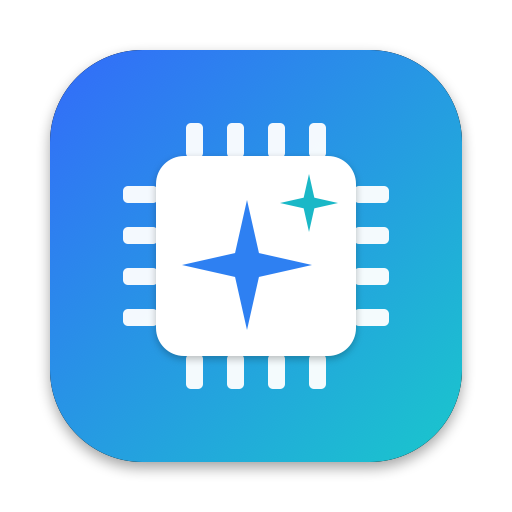
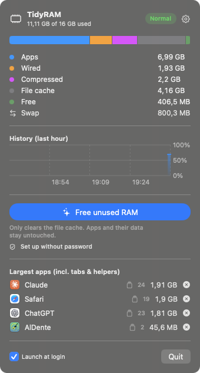
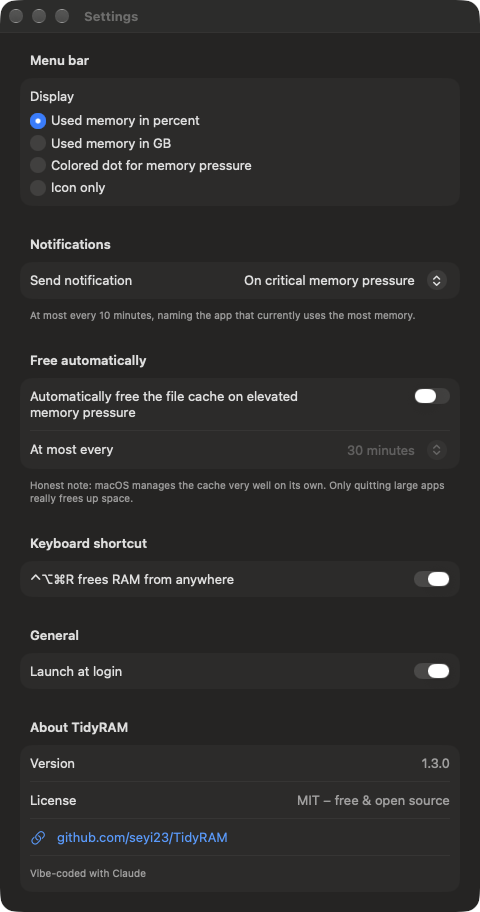

<p align="center">
  
</p>

# TidyRAM

[Deutsch](README.md) | **English**

[](https://github.com/seyi23/TidyRAM/actions/workflows/build.yml)
[](https://github.com/seyi23/TidyRAM/releases/latest)
[](LICENSE)
[](#how-it-was-made-vibe-coding-with-claude)

A lightweight macOS menu bar app that shows your memory usage at a glance and safely frees unused RAM (the file cache) without touching running apps or their data.

<p align="center">
  
</p>

> **Free and open source.** TidyRAM is MIT-licensed. You may use it for free, read, modify and share the source code. No ads, no tracking, no network access, no in-app purchases.

> 🤖 **Vibe-coded with Claude.** TidyRAM was built entirely through *vibe coding*: I described what the app should do, and [Claude](https://claude.com/claude-code) by Anthropic wrote the code, the scripts and this documentation. More under [How it was made](#how-it-was-made-vibe-coding-with-claude).

- **Platform:** macOS 14 (Sonoma) or later, Apple Silicon and Intel (tested on macOS 27.2, Apple Silicon)
- **App languages:** English and German (follows your system language)
- **Tech:** Swift 6 / SwiftUI, no external dependencies
- **Version:** 1.3.0 ([changelog](CHANGELOG.md), in German)
- **Download:** [latest release](https://github.com/seyi23/TidyRAM/releases/latest) or via [Homebrew](#option-2-homebrew)
- **License:** MIT (free, open source)

---

## Contents

1. [Features](#features)
2. [What the app does and doesn't do](#what-the-app-does-and-doesnt-do)
3. [Installation](#installation)
4. [Usage](#usage)
5. [Settings](#settings)
6. [Memory categories explained](#memory-categories-explained)
7. [How freeing memory works](#how-freeing-memory-works)
8. [Password prompt: problem and workaround](#password-prompt-problem-and-workaround)
9. [Checking memory in Terminal](#checking-memory-in-terminal)
10. [Project structure](#project-structure)
11. [Technical details](#technical-details)
12. [Uninstalling](#uninstalling)
13. [Known limitations](#known-limitations)
14. [Building the PDF docs](#building-the-pdf-docs)
15. [How it was made: vibe coding with Claude](#how-it-was-made-vibe-coding-with-claude)
16. [Contributing](#contributing)
17. [License](#license)

---

## Features

| Feature | Description |
|---|---|
| **Live menu bar display** | Chip icon with used memory in percent or GB, a colored dot for memory pressure, or the icon only. Updated every 2 seconds. |
| **Memory overview** | Colored bar and legend: Apps, Wired, Compressed, File cache, Free and Swap. Same numbers as Activity Monitor. |
| **Memory pressure** | *Normal*, *Elevated* or *Critical* badge, straight from the macOS kernel. |
| **History chart** | Used memory over the last hour. Periods of elevated or critical pressure are shaded yellow or red. |
| **Free unused RAM** | Clears the file cache with Apple's `purge` and shows how much was freed. |
| **Shortcut ⌃⌥⌘R** | Frees RAM from anywhere without opening the window. The result appears as a notification. |
| **Notifications** | Alerts you when memory gets low, naming the app that uses the most. At most every 10 minutes. |
| **Free automatically (optional)** | Clears the cache on elevated memory pressure, at most every 15, 30 or 60 minutes. Off by default. |
| **No password (optional)** | A narrowly scoped sudo rule lets freeing run without a password dialog. The app shows whether it's active. |
| **Largest apps** | The 8 apps using the most memory, **including all tabs and helper processes** (Safari, Chrome, Firefox, Electron apps). Click ✕ to quit one normally (like ⌘Q). |
| **Settings window** | All options in one place, see [Settings](#settings). |
| **Launch at login** | Via the official macOS API (`SMAppService`). |

---

## What the app does and doesn't do

**macOS manages memory on its own, and does it very well.** Free RAM is wasted RAM, so macOS deliberately fills it with a file cache. Almost no "free" memory is therefore **normal and not a problem**.

TidyRAM is deliberately **cautious**:

| ✅ The app … | ❌ The app … |
|---|---|
| only clears the file cache, i.e. data that's already on the SSD | never quits apps without asking |
| quits apps only on click and normally (the app can ask to save) | never force-quits (no `kill -9`, no `forceTerminate`) |
| shows the real memory pressure | never touches other processes' memory |
| runs exactly one hard-coded command with admin rights | installs no background services or kernel extensions |
| stores settings locally only | has no network access and collects no data |

**When does freeing really help?** Mostly right before a memory-hungry task (video export, VM, large builds), or to see how much RAM is really needed.

**When doesn't it help?** If memory pressure stays *Elevated* and many GB are compressed or swapped, your apps need more RAM than the Mac has. Only quitting large apps helps then, for example a second browser. That's what the *Largest apps* list is for.

---

## Installation

### Option 1: Download the app (easiest)

1. Download `TidyRAM-<version>.zip` from [**Releases**](https://github.com/seyi23/TidyRAM/releases/latest).
2. Unzip it and drag `TidyRAM.app` into your **Applications** folder.
3. Open TidyRAM. On first launch macOS says the app can't be verified, because it isn't notarized by Apple (see [First launch](#first-launch)). To open it anyway:
    - **System Settings → Privacy & Security**, scroll down, click **"Open Anyway"** next to TidyRAM and confirm.
    - Or remove the download flag in Terminal:
      ```bash
      xattr -dr com.apple.quarantine /Applications/TidyRAM.app
      ```

The app runs on Apple Silicon and Intel (universal binary).

### Option 2: Homebrew

```bash
brew install --cask seyi23/tidyram/tidyram
```

Homebrew downloads the same ZIP from the releases and puts the app into **Applications**. The one-time approval on first launch (see option 1) is still needed. Update with `brew upgrade --cask tidyram`.

### Option 3: Build it yourself

**Requirements:**

- macOS 14 or later
- Xcode or the Xcode Command Line Tools:
  ```bash
  xcode-select --install
  ```

**Build and install:**

```bash
git clone https://github.com/seyi23/TidyRAM.git
```
```bash
cd TidyRAM
```
```bash
./scripts/install.sh
```

The script builds the app, copies it to `/Applications` and launches it. The chip icon then appears at the top right of the menu bar.

**Build only:**

```bash
./build.sh
```

The result is `build/TidyRAM.app`. `./build.sh --universal` builds for Apple Silicon **and** Intel.

### First launch

The app is only ad-hoc signed and not notarized by Apple. Notarization requires a paid Apple Developer account.

- **Built yourself:** launches without asking.
- **Downloaded or via Homebrew:** Gatekeeper blocks the first launch. Approve it as described in option 1. You only need to do this once.

---

## Usage

Click the **chip icon** in the menu bar. A window opens with:

1. **Header:** used memory ("11.1 GB of 16 GB used"), the memory pressure badge and the **gear** for [Settings](#settings).
2. **Bar and legend:** how RAM is split up, see [Memory categories](#memory-categories-explained).
3. **History (last hour):** used memory in percent. Periods of elevated or critical pressure are shaded yellow or red. The chart fills up while TidyRAM is running (one data point every 10 seconds).
4. **"Free unused RAM":** clears the file cache. Below it you see
    - the result, e.g. *"1.9 GB freed"*,
    - the password status: 🔒 *Asks for password* or ✔︎ *Set up without password*.
5. **Largest apps:** memory per app including all tabs and helper processes. The small number with the stack icon shows how many processes belong to it. Click ✕ to quit the app normally. Unsaved documents trigger the app's usual "Save?" dialog. Finder, Dock and other system processes are never listed.
6. **Footer:** *Launch at login* and *Quit*.

**Keyboard shortcut:** **⌃⌥⌘R** (Control + Option + Command + R) frees RAM from anywhere. The result appears as a notification. You can turn the shortcut off in Settings.

---

## Settings

Open them with the **gear** in the TidyRAM window. All changes apply immediately.

<p align="center">
  
</p>

| Section | Options |
|---|---|
| **Menu bar** | What's shown next to the icon: percent, GB, a colored dot for memory pressure (green, yellow, red), or the icon only |
| **Notifications** | *Never*, *On critical memory pressure* (default) or *Already on elevated memory pressure*. macOS asks once whether TidyRAM may send notifications |
| **Free automatically** | Off (default) or on, at most every 15, 30 or 60 minutes. **Only available if [freeing without password](#password-prompt-problem-and-workaround) is set up.** Otherwise a password dialog would pop up out of nowhere |
| **Keyboard shortcut** | ⌃⌥⌘R on (default) or off |
| **General** | Launch at login |
| **About TidyRAM** | Version, license, link to the repository |

Settings are stored locally in `~/Library/Preferences/local.tidyram.plist`.

---

## Memory categories explained

| Category | Meaning | Can be freed? |
|---|---|---|
| **Apps** | Memory that apps allocated themselves (documents, tabs, data) | Only by quitting the app |
| **Wired** | Locked by the macOS kernel, can never be swapped out | No |
| **Compressed** | Space used by the memory compressor. macOS compresses rarely used app data instead of swapping it to the SSD | Only by quitting apps |
| **File cache** | Copies of files and program code that are on the SSD anyway | **Yes**, that's what the button does |
| **Free** | Completely unused | – |
| **Swap** | Memory swapped out to the SSD (not in RAM) | Only by quitting apps |

**"Used"** in the app = Apps + Wired + Compressed. That's the same definition as *Memory Used* in Activity Monitor. The file cache doesn't count because macOS can free it instantly at any time.

**Memory pressure:** This is the most important number. It tells you whether macOS is really struggling to provide enough memory:

- 🟢 **Normal:** all good, no matter how little is "free"
- 🟡 **Elevated:** macOS is compressing and swapping, the Mac may slow down
- 🔴 **Critical:** severe shortage, quit apps

---

## How freeing memory works

The button runs `/usr/sbin/purge`, a tool Apple ships with every copy of macOS.

**What purge does:** It discards all pages in the file cache, i.e. memory whose content has an identical copy on the SSD (files that were read, program code, libraries).

**Why it's safe:**

- Data that apps created themselves lives in *Apps* or *Compressed*. purge does **not** touch it.
- No process is quit or modified.
- Worst case: a file gets reloaded from the SSD once on next access. That's briefly a bit slower, then it's cached again.

**Why admin rights?** purge only runs as `root`. So the app tries, in order:

1. `sudo -n /usr/sbin/purge`: works without a password **if** the sudo rule is set up (next section). `-n` means sudo never prompts and fails immediately instead.
2. Otherwise: AppleScript `do shell script … with administrator privileges`. macOS then shows its own password dialog.

The path `/usr/sbin/purge` is **hard-coded** ([`Sources/Cleaner.swift`](Sources/Cleaner.swift)). Nothing else is ever run with admin rights.

---

## Password prompt: problem and workaround

### The problem

Without further setup, macOS shows this dialog **every time** you click "Free unused RAM":

> **Allow admin access for a script started by "TidyRAM"?**
> This gives the script access to your data, files and settings … Apple could not verify that the script is free of malware …

**Why it sounds so scary:**

- *"Access to your data, files and settings"* is **boilerplate**. macOS shows it for every script that requests admin rights, no matter what it does.
- *"Apple could not verify …"* appears because the app is only ad-hoc signed and **not notarized by Apple**. That applies to every self-built app. It does **not** mean malware was found.
- Since macOS 26/27, the system replaces the app's own prompt text with this warning.

"Allow" is harmless here, because only `/usr/sbin/purge` is run. But it gets annoying. Also, **free automatically** and a smooth **keyboard shortcut** require that no dialog appears.

### The solution: a sudo rule for purge only

We allow **exactly one command**, `/usr/sbin/purge`, without a password, and **only for your user**. Every other sudo command still asks for your password.

The rule is a single line in `/etc/sudoers.d/tidyram`:

```
<your-user> ALL=(root) NOPASSWD: /usr/sbin/purge
```

#### Setup: option A, with the script (recommended)

```bash
./scripts/enable-passwordless.sh
```

#### Setup: option B, a single command

```bash
echo "$(whoami) ALL=(root) NOPASSWD: /usr/sbin/purge" > /tmp/tidyram && visudo -cf /tmp/tidyram && sudo install -m 440 -o root -g wheel /tmp/tidyram /etc/sudoers.d/tidyram && rm /tmp/tidyram
```

What this command does, step by step:

| Step | Purpose |
|---|---|
| `echo "$(whoami) ALL=(root) NOPASSWD: /usr/sbin/purge" > /tmp/tidyram` | Writes the rule with your user name to a temporary file |
| `visudo -cf /tmp/tidyram` | **Checks the syntax.** A broken file in `/etc/sudoers.d` could disable sudo entirely. On an error the chain stops here |
| `sudo install -m 440 -o root -g wheel …` | Copies the file with the permissions sudo requires (owned by root, read-only). **This is where you enter your password one last time** |
| `rm /tmp/tidyram` | Cleans up the temporary file |

The only output is `/tmp/tidyram: parsed OK`. That's expected, the other steps are silent.

#### Check

```bash
sudo -n -l /usr/sbin/purge
```

| Output | Meaning |
|---|---|
| `/usr/sbin/purge` | ✅ Rule active, purge runs without a password |
| `sudo: a password is required` | ❌ Rule not active |

In TidyRAM, the status below the button switches to ✔︎ *Set up without password* within a minute, or immediately after restarting the app.

#### Undo

```bash
./scripts/disable-passwordless.sh
```

or directly:

```bash
sudo rm /etc/sudoers.d/tidyram
```

The app keeps working and shows the password dialog again when freeing. Automatic freeing pauses.

#### Security considerations

| Aspect | Assessment |
|---|---|
| What's allowed without a password? | Only `/usr/sbin/purge`, without arguments, as root |
| Who may do it? | Only your user account |
| What could malware running as your user do with it? | Clear the file cache. That costs a bit of speed briefly, nothing more |
| Can it be used to run other commands as root? | No. sudo only allows this exact path, and `/usr/sbin` is write-protected by System Integrity Protection (SIP) |

#### Troubleshooting

| Symptom | Cause and fix |
|---|---|
| Only `parsed OK`, but `sudo -n -l` still says "password is required" | The `sudo install` step didn't run (e.g. password prompt cancelled). Run the command again in Terminal and enter your password |
| `visudo` reports a syntax error | Nothing was installed. Check that `whoami` prints your short user name (no spaces) |
| App still shows "Asks for password" | Wait up to 60 s, or quit the app via *Quit* and reopen it |
| `sudo` doesn't work at all anymore | Very unlikely thanks to `visudo -c`. If it happens: delete `/etc/sudoers.d/tidyram` in Finder (⌘⇧G → `/etc/sudoers.d`), or boot into macOS Recovery and delete it there |

### Alternatives

| Solution | Pro | Con |
|---|---|---|
| **Enter the password every time** | No system change | Annoying, warning dialog on every click, no automatic freeing |
| **sudo rule (above)** | No more dialog, narrowly scoped, reversible any time | One-time setup in Terminal |
| **Signed helper daemon** (`SMAppService.daemon`) | No dialog, no warning, the "official" way | Requires a paid Apple Developer account ($99/year), Developer ID signing and notarization |

---

## Checking memory in Terminal

macOS has no `free` like Linux. These commands come closest:

| Command | Shows |
|---|---|
| `top -l 1 \| grep PhysMem` | Quick summary: used, wired, compressor, unused |
| `vm_stat` | All counters in pages (16 KB on Apple Silicon, 4 KB on Intel) |
| `memory_pressure` | Memory pressure and "System-wide memory free percentage" |
| `sysctl vm.swapusage` | Swap usage |
| `sysctl -n hw.memsize` | Installed RAM in bytes |
| `top -o mem` | Processes sorted by memory (like `htop`) |

### How Terminal and app numbers match

| App | `vm_stat` line | Conversion |
|---|---|---|
| Compressed | `Pages occupied by compressor` | × 16 KB |
| Free | `Pages free` | × 16 KB |
| Apps | `Anonymous pages` − `Pages purgeable` | × 16 KB |
| File cache | `File-backed pages` + `Pages purgeable` | × 16 KB |
| Wired | `Pages wired down` | × 16 KB |
| Swap | `sysctl vm.swapusage` → `used` | as is |

**Why does `top` say "15G used" but the app "13 GB used"?** `top` counts everything except "unused", including the file cache. The app counts like Activity Monitor: Apps + Wired + Compressed only.

**Why does `memory_pressure` say "41% free" when only 80 MB are free?** That number is the kernel's estimate of how much it could make available if needed, including the file cache and inactive pages.

Small values fluctuate every second. Differences of a few hundred MB between two measurements are normal.

### Bonus: a `free` function for zsh

Add to `~/.zshrc`:

```bash
free() { vm_stat | awk -v total=$(sysctl -n hw.memsize) '/page size of/{ps=$8} /Pages free/{f=$3} /Pages active/{a=$3} /Pages inactive/{i=$3} /Pages wired/{w=$4} /occupied by compressor/{c=$5} END{g=1024^3; printf "Total: %.1f GB\nActive: %.1f GB\nInactive: %.1f GB\nWired: %.1f GB\nCompressed: %.1f GB\nFree: %.1f GB\n", total/g, a*ps/g, i*ps/g, w*ps/g, c*ps/g, f*ps/g}'; sysctl -n vm.swapusage; }
```

---

## Project structure

```
TidyRAM/
├── Sources/
│   ├── TidyRAMApp.swift        Entry point, menu bar label, settings scene
│   ├── ContentView.swift       Window: bar, legend, history, button, app list
│   ├── SettingsView.swift      Settings window
│   ├── AppSettings.swift       Settings (stored in UserDefaults)
│   ├── MemoryMonitor.swift     Data model: values, history, notifications, auto-free
│   ├── MemoryStats.swift       Reads RAM and per-app usage from the kernel (read-only)
│   ├── Cleaner.swift           Runs purge (sudo -n or password dialog)
│   ├── Notifier.swift          macOS notifications
│   └── GlobalHotKey.swift      Keyboard shortcut ⌃⌥⌘R
├── Resources/
│   ├── AppIcon.icns            App icon (generated by scripts/make-icon.swift)
│   ├── de.lproj/               German (development language)
│   └── en.lproj/               English translation
├── scripts/
│   ├── install.sh              Build + install to /Applications + launch
│   ├── enable-passwordless.sh  Set up the sudo rule for purge
│   ├── disable-passwordless.sh Remove the sudo rule
│   ├── uninstall.sh            Remove app and sudo rule
│   ├── make-icon.swift         Draws the app icon in code
│   ├── make-pdf.sh             README → docs/TidyRAM.pdf and docs/TidyRAM-en.pdf
│   └── update-homebrew.sh      Updates the Homebrew cask after a release
├── docs/                       Icon, screenshots, PDF docs (German + English)
├── .github/
│   ├── workflows/              build.yml (every push), release.yml (every version tag)
│   ├── ISSUE_TEMPLATE/         Templates for bug reports and ideas
│   └── pull_request_template.md
├── build.sh                    Compiles and creates build/TidyRAM.app
├── CHANGELOG.md                Changes per version (German)
├── CONTRIBUTING.md             How to contribute (German + English)
├── README.md / README.en.md    This documentation (German / English)
├── LICENSE
└── .gitignore
```

The code comments are in German. They're detailed, and any translation tool handles them well.

---

## Technical details

| Topic | Implementation |
|---|---|
| UI | SwiftUI `MenuBarExtra` with `.window` style plus a `Settings` scene, `LSUIElement` (no Dock icon) |
| Data flow | `@Observable` + `@MainActor` model, refreshed every 2 s by a `Task` loop |
| Memory values | Mach API `host_statistics64(HOST_VM_INFO64)` |
| Memory pressure | `sysctl kern.memorystatus_vm_pressure_level` (1/2/4) |
| Swap | `sysctl vm.swapusage` |
| Per-app usage | `proc_pid_rusage(RUSAGE_INFO_V4).ri_phys_footprint` for **all** processes (`proc_listallpids`), summed per responsible app via `responsibility_get_pid_responsible_for_pid`. That function isn't officially documented, so it's looked up at runtime via `dlsym`. If it's missing, each process counts on its own. Takes about 5 ms |
| History | One data point every 10 s, at most 1 hour (360 points) kept in memory, drawn with Swift Charts. Nothing is written to disk |
| Notifications | `UserNotifications`. Only when entering the critical range, at most every 10 minutes |
| Keyboard shortcut | Carbon `RegisterEventHotKey`. Needs **no** Accessibility permission, because it only captures this one shortcut and reads no other keystrokes |
| Quitting apps | `NSRunningApplication.terminate()`, normal quit, never forced |
| Freeing | `/usr/sbin/purge` via `sudo -n`, falling back to `osascript … with administrator privileges` |
| Settings | `UserDefaults` (`~/Library/Preferences/local.tidyram.plist`) |
| Localization | `Localizable.strings` in `de.lproj` and `en.lproj`. German is the development language, so the German strings in the code double as keys |
| Launch at login | `SMAppService.mainApp` |
| Concurrency | Swift 6 language mode (strict data-race checking). External processes run in `Task.detached` so the UI never blocks |
| Build | Plain `swiftc`, no Xcode project, ad-hoc signed. `--universal` uses `lipo` to build for arm64 and x86_64 |
| App icon | Drawn with CoreGraphics (`scripts/make-icon.swift`), bundled into `.icns` with `iconutil` |
| CI / releases | GitHub Actions: `build.yml` builds on every push. `release.yml` builds on a `vX.Y.Z` tag and publishes `TidyRAM-X.Y.Z.zip` with the matching section from `CHANGELOG.md` |
| Homebrew | Own tap repository [seyi23/homebrew-tidyram](https://github.com/seyi23/homebrew-tidyram), updated with `scripts/update-homebrew.sh` |

---

## Uninstalling

```bash
./scripts/uninstall.sh
```

The script quits the app, deletes `/Applications/TidyRAM.app` and removes the sudo rule (if present). Turn off *Launch at login* in the app first, or remove the entry under *System Settings → General → Login Items*.

Installed via Homebrew:

```bash
brew uninstall --cask --zap tidyram
```

---

## Known limitations

- **The effect is temporary:** macOS refills the file cache after freeing, and that's intended.
- **Not notarized:** hence the warning on first launch and in the password dialog, see [above](#password-prompt-problem-and-workaround).
- **History is in memory only:** after restarting TidyRAM the chart starts over.
- **Shortcut already taken?** If another app already uses ⌃⌥⌘R, TidyRAM can't register it. Turn it off in Settings then.
- **After a new build** you need to copy the app to `/Applications` again (`./scripts/install.sh` does that).

---

## Building the PDF docs

```bash
./scripts/make-pdf.sh
```

Creates `docs/TidyRAM.pdf` (German) and `docs/TidyRAM-en.pdf` (English). Requires Google Chrome and Python 3. On first run the script creates a local `.venv/` with the `markdown` package.

---

## How it was made: vibe coding with Claude

TidyRAM is a **vibe coding project**. I didn't write any code by hand. Instead I described what I wanted in a conversation with **Claude** (Anthropic, model Claude Opus 5.5, in the Claude desktop app with Claude Code). Claude built the app from that, step by step.

**How it went:**

1. **Idea:** "A macOS app that frees unused RAM without losing important information or damaging apps."
2. **Built by Claude:** Swift/SwiftUI code, build script, app icon, localization, GitHub workflows, Homebrew cask, README and PDF.
3. **Tested on a real Mac:** memory values checked against `vm_stat`, `top` and `memory_pressure`, freeing tried out, screenshots checked in both languages.
4. **Refined in conversation:** for example the password-prompt workaround, counting browser tabs correctly, a new name, going open source, and checking the repo for private data.

**What this means for you:**

- The code is **thoroughly commented** so anyone can follow what it does. For a tool with admin rights it's worth a look of your own, especially at [`Sources/Cleaner.swift`](Sources/Cleaner.swift).
- The safety principles (only `purge`, no force-quitting, read-only access to other processes) were set deliberately and are documented in the code and in this README.
- Commits are marked with `Co-Authored-By: Claude`.

Found a bug or have an idea? [Open an issue](https://github.com/seyi23/TidyRAM/issues/new/choose). Fixes made with vibe coding are welcome too.

---

## Contributing

Bug reports, ideas, translations and pull requests are welcome. Everything you need is in [CONTRIBUTING.md](CONTRIBUTING.md), including:

- how to build and test,
- how to add **another language** (copy one file and translate it),
- how a new version gets released.

The rule for every change: **nothing may damage apps or put data at risk.** No force-quitting, no interfering with other processes, admin rights only for hard-coded Apple tools, no network access.

---

## License

TidyRAM is **free and open source** under the [MIT License](LICENSE). You may use, copy, modify and distribute it, including commercially, as long as the license notice is kept. The software is provided without warranty.
