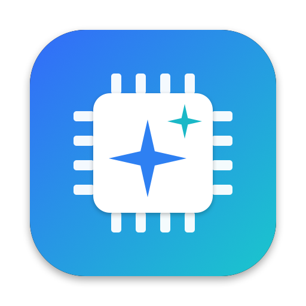
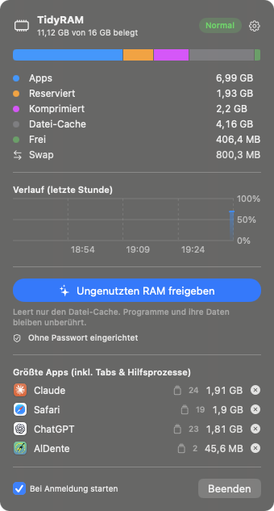
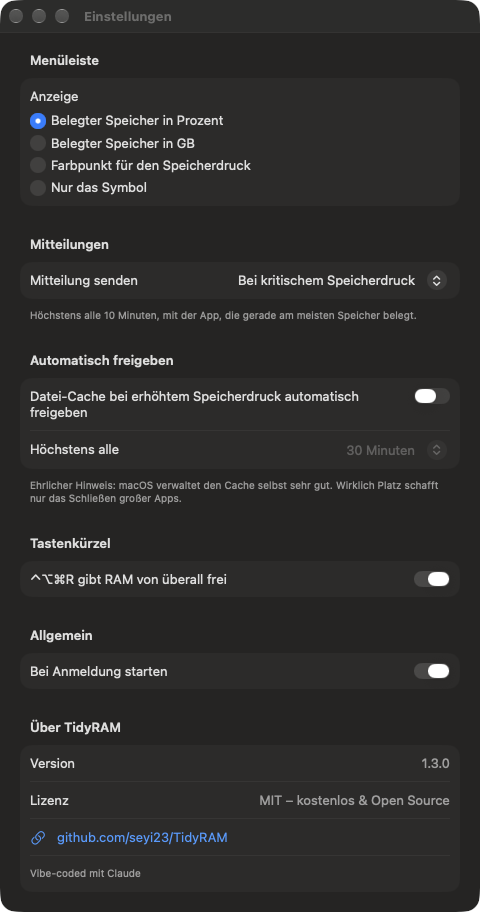

<p align="center">
  
</p>

# TidyRAM

**Deutsch** | [English](README.en.md)

[](https://github.com/seyi23/TidyRAM/actions/workflows/build.yml)
[](https://github.com/seyi23/TidyRAM/releases/latest)
[](LICENSE)
[](#entstehung-vibe-coding-mit-claude)

Eine schlanke Menüleisten-App für macOS, die den Arbeitsspeicher übersichtlich anzeigt und ungenutzten RAM (den Datei-Cache) sicher freigibt, ohne laufende Programme oder deren Daten anzutasten.

<p align="center">
  
</p>

> **Kostenlos und Open Source.** TidyRAM steht unter der MIT-Lizenz. Du darfst die App kostenlos nutzen, den Quellcode lesen, ändern und weitergeben. Es gibt keine Werbung, kein Tracking, keine Netzwerkzugriffe und keine In-App-Käufe.

> 🤖 **Vibe Coding mit Claude.** TidyRAM ist komplett per *Vibe Coding* entstanden: Ich habe beschrieben, was die App können soll, und [Claude](https://claude.com/claude-code) von Anthropic hat den Code, die Skripte und diese Dokumentation geschrieben. Mehr dazu unter [Entstehung](#entstehung-vibe-coding-mit-claude).

- **Plattform:** macOS 14 (Sonoma) oder neuer, Apple Silicon und Intel (getestet auf macOS 27.2, Apple Silicon)
- **Sprachen der App:** Deutsch und Englisch (folgt der Systemsprache)
- **Technik:** Swift 6 / SwiftUI, keine externen Abhängigkeiten
- **Version:** 1.3.0 ([Änderungen](CHANGELOG.md))
- **Download:** [neueste Version](https://github.com/seyi23/TidyRAM/releases/latest) oder per [Homebrew](#variante-2-homebrew)
- **Lizenz:** MIT (kostenlos, Open Source)

---

## Inhalt

1. [Funktionen](#funktionen)
2. [Was die App macht und was nicht](#was-die-app-macht-und-was-nicht)
3. [Installation](#installation)
4. [Bedienung](#bedienung)
5. [Einstellungen](#einstellungen)
6. [Die Speicherbereiche erklärt](#die-speicherbereiche-erklärt)
7. [Wie das Freigeben funktioniert](#wie-das-freigeben-funktioniert)
8. [Passwortabfrage: Problem und Workaround](#passwortabfrage-problem-und-workaround)
9. [Speicher im Terminal ansehen](#speicher-im-terminal-ansehen)
10. [Projektstruktur](#projektstruktur)
11. [Technische Details](#technische-details)
12. [Deinstallation](#deinstallation)
13. [Bekannte Einschränkungen](#bekannte-einschränkungen)
14. [Dokumentation als PDF erzeugen](#dokumentation-als-pdf-erzeugen)
15. [Entstehung: Vibe Coding mit Claude](#entstehung-vibe-coding-mit-claude)
16. [Mitmachen](#mitmachen)
17. [Lizenz](#lizenz)

---

## Funktionen

| Funktion | Beschreibung |
|---|---|
| **Live-Anzeige in der Menüleiste** | Chip-Symbol mit belegtem Speicher in Prozent oder GB, einem Farbpunkt für den Speicherdruck oder nur dem Symbol. Alle 2 Sekunden aktualisiert. |
| **Speicherübersicht** | Farbiger Balken und Legende: Apps, Reserviert, Komprimiert, Datei-Cache, Frei und Swap. Gleiche Werte wie in der Aktivitätsanzeige. |
| **Speicherdruck** | Badge *Normal*, *Erhöht* oder *Kritisch*, direkt vom macOS-Kernel. |
| **Verlaufsgrafik** | Belegter Speicher der letzten Stunde. Zeiten mit erhöhtem oder kritischem Druck sind gelb bzw. rot hinterlegt. |
| **Ungenutzten RAM freigeben** | Leert den Datei-Cache mit Apples `purge` und zeigt an, wie viel frei wurde. |
| **Tastenkürzel ⌃⌥⌘R** | Gibt RAM von überall frei, ohne das Fenster zu öffnen. Das Ergebnis kommt als Mitteilung. |
| **Mitteilungen** | Hinweis, wenn der Speicher knapp wird, mit der App, die gerade am meisten belegt. Höchstens alle 10 Minuten. |
| **Automatisch freigeben (optional)** | Bei erhöhtem Speicherdruck den Cache selbst leeren, höchstens alle 15, 30 oder 60 Minuten. Standardmäßig aus. |
| **Ohne Passwort (optional)** | Mit einer eng begrenzten sudo-Regel läuft das Freigeben ohne Passwortdialog. Die App zeigt an, ob das aktiv ist. |
| **Größte Apps** | Die 8 Programme mit dem größten Speicherverbrauch, **inklusive aller Tabs und Hilfsprozesse** (Safari, Chrome, Firefox, Electron-Apps). Mit ✕ beendest du sie regulär (wie ⌘Q). |
| **Einstellungsfenster** | Alle Optionen an einem Ort, siehe [Einstellungen](#einstellungen). |
| **Bei Anmeldung starten** | Autostart über die offizielle macOS-API (`SMAppService`). |

---

## Was die App macht und was nicht

**macOS verwaltet den Arbeitsspeicher selbst, und das sehr gut.** Freier RAM ist verschwendeter RAM, deshalb füllt macOS ihn absichtlich mit einem Datei-Cache. Fast leerer „freier“ Speicher ist also **normal und kein Problem**.

TidyRAM ist bewusst **vorsichtig** gebaut:

| ✅ Die App … | ❌ Die App … |
|---|---|
| leert nur den Datei-Cache, also Daten, die ohnehin auf der SSD liegen | beendet keine Programme ungefragt |
| beendet Apps nur auf Klick und regulär (die App kann nach dem Sichern fragen) | erzwingt kein Beenden (kein `kill -9`, kein `forceTerminate`) |
| zeigt den echten Speicherdruck an | manipuliert keinen Speicher fremder Prozesse |
| führt mit Admin-Rechten nur einen einzigen, fest eingetragenen Befehl aus | installiert keine Hintergrunddienste oder Kernel-Erweiterungen |
| speichert Einstellungen nur lokal | greift nicht aufs Netzwerk zu und sammelt keine Daten |

**Wann hilft das Freigeben wirklich?** Vor allem kurz vor einer speicherhungrigen Aufgabe (Video-Export, VM, große Builds), oder um zu sehen, wie viel RAM wirklich gebraucht wird.

**Wann hilft es nicht?** Steht der Speicherdruck dauerhaft auf *Erhöht* und sind viele GB komprimiert oder im Swap, brauchen deine Programme mehr RAM, als der Mac hat. Dann hilft nur, große Programme zu schließen, zum Beispiel einen zweiten Browser. Dafür ist die Liste *Größte Apps* gedacht.

---

## Installation

### Variante 1: Fertige App herunterladen (am einfachsten)

1. Unter [**Releases**](https://github.com/seyi23/TidyRAM/releases/latest) die Datei `TidyRAM-<version>.zip` herunterladen.
2. Entpacken und `TidyRAM.app` in den Ordner **Programme** ziehen.
3. TidyRAM öffnen. Beim ersten Start meldet macOS, dass die App nicht überprüft werden kann. Das liegt daran, dass sie nicht von Apple notarisiert ist (siehe [Hinweis zum ersten Start](#hinweis-zum-ersten-start)). So öffnest du sie trotzdem:
    - **Systemeinstellungen → Datenschutz & Sicherheit**, ganz nach unten scrollen, bei TidyRAM auf **„Dennoch öffnen“** klicken und bestätigen.
    - Oder im Terminal das Download-Kennzeichen entfernen:
      ```bash
      xattr -dr com.apple.quarantine /Applications/TidyRAM.app
      ```

Die App läuft auf Apple Silicon und Intel (Universal Binary).

### Variante 2: Homebrew

```bash
brew install --cask seyi23/tidyram/tidyram
```

Homebrew lädt dieselbe ZIP-Datei aus den Releases und legt die App in **Programme** ab. Auch hier ist beim ersten Start einmal die Freigabe wie in Variante 1 nötig. Updates gibt es mit `brew upgrade --cask tidyram`.

### Variante 3: Selbst bauen

**Voraussetzungen:**

- macOS 14 oder neuer
- Xcode oder die Xcode Command Line Tools:
  ```bash
  xcode-select --install
  ```

**Bauen und installieren:**

```bash
git clone https://github.com/seyi23/TidyRAM.git
```
```bash
cd TidyRAM
```
```bash
./scripts/install.sh
```

Das Skript baut die App, kopiert sie nach `/Applications` und startet sie. Danach erscheint das Chip-Symbol oben rechts in der Menüleiste.

**Nur bauen:**

```bash
./build.sh
```

Das Ergebnis liegt in `build/TidyRAM.app`. Mit `./build.sh --universal` entsteht eine Version für Apple Silicon **und** Intel.

### Hinweis zum ersten Start

Die App ist nur lokal signiert (ad hoc) und nicht von Apple notarisiert. Eine Notarisierung setzt ein kostenpflichtiges Apple-Entwicklerkonto voraus.

- **Selbst gebaut:** startet ohne Rückfrage.
- **Heruntergeladen oder per Homebrew:** Gatekeeper blockiert den ersten Start. Freigabe wie oben unter Variante 1 beschrieben. Das ist nur einmal nötig.

---

## Bedienung

Klicke auf das **Chip-Symbol** in der Menüleiste. Es öffnet sich ein Fenster mit:

1. **Kopf:** belegter Speicher („11,1 GB von 16 GB belegt“), das Badge mit dem Speicherdruck und das **Zahnrad** für die [Einstellungen](#einstellungen).
2. **Balken und Legende:** die Aufteilung des RAM, siehe [Speicherbereiche](#die-speicherbereiche-erklärt).
3. **Verlauf (letzte Stunde):** belegter Speicher in Prozent. Gelb bzw. rot hinterlegt sind Zeiten mit erhöhtem oder kritischem Speicherdruck. Die Grafik füllt sich, solange TidyRAM läuft (alle 10 Sekunden ein Messpunkt).
4. **„Ungenutzten RAM freigeben“:** leert den Datei-Cache. Darunter stehen
    - das Ergebnis, z. B. *„1,9 GB freigegeben“*,
    - der Passwort-Status: 🔒 *Fragt nach Passwort* oder ✔︎ *Ohne Passwort eingerichtet*.
5. **Größte Apps:** Speicher pro App inklusive aller Tabs und Hilfsprozesse. Die kleine Zahl mit dem Stapel-Symbol zeigt, wie viele Prozesse dazugehören. Klick auf ✕ beendet die App regulär. Ungesicherte Dokumente lösen den normalen „Sichern?“-Dialog der App aus. Finder, Dock und andere Systemprozesse werden nie angeboten.
6. **Fußzeile:** *Bei Anmeldung starten* und *Beenden*.

**Tastenkürzel:** Mit **⌃⌥⌘R** (Control + Option + Command + R) gibst du RAM von überall frei. Das Ergebnis erscheint als Mitteilung. Das Kürzel lässt sich in den Einstellungen abschalten.

---

## Einstellungen

Erreichbar über das **Zahnrad** im TidyRAM-Fenster. Alle Änderungen gelten sofort.

<p align="center">
  
</p>

| Bereich | Optionen |
|---|---|
| **Menüleiste** | Was neben dem Symbol steht: Prozent, GB, Farbpunkt für den Speicherdruck (grün, gelb, rot) oder nur das Symbol |
| **Mitteilungen** | *Nie*, *Bei kritischem Speicherdruck* (Standard) oder *Schon bei erhöhtem Speicherdruck*. Beim ersten Mal fragt macOS, ob TidyRAM Mitteilungen senden darf |
| **Automatisch freigeben** | Aus (Standard) oder an, mit Mindestabstand 15, 30 oder 60 Minuten. **Nur verfügbar, wenn [Freigeben ohne Passwort](#passwortabfrage-problem-und-workaround) eingerichtet ist.** Sonst würde unvermittelt ein Passwortdialog erscheinen |
| **Tastenkürzel** | ⌃⌥⌘R an (Standard) oder aus |
| **Allgemein** | Bei Anmeldung starten |
| **Über TidyRAM** | Version, Lizenz, Link zum Repository |

Gespeichert werden die Einstellungen lokal in `~/Library/Preferences/local.tidyram.plist`.

---

## Die Speicherbereiche erklärt

| Bereich | Bedeutung | Freigebbar? |
|---|---|---|
| **Apps** | Speicher, den Programme selbst angelegt haben (Dokumente, Tabs, Daten) | Nur durch Beenden der App |
| **Reserviert** (wired) | Vom macOS-Kernel fest belegt, kann nie ausgelagert werden | Nein |
| **Komprimiert** | Platz, den der Speicherkompressor belegt. macOS presst selten genutzte App-Daten zusammen, statt sie auf die SSD auszulagern | Nur durch Beenden von Apps |
| **Datei-Cache** | Kopien von Dateien und Programmcode, die auf der SSD liegen | **Ja**, das macht der Button |
| **Frei** | Komplett unbenutzt | – |
| **Swap** | Auf die SSD ausgelagerter Speicher (nicht im RAM) | Nur durch Beenden von Apps |

**„Belegt“** in der App = Apps + Reserviert + Komprimiert. Das ist dieselbe Definition wie *Benutzter Speicher* in der Aktivitätsanzeige. Der Datei-Cache zählt nicht dazu, weil macOS ihn jederzeit sofort freigeben kann.

**Speicherdruck:** Das ist der wichtigste Wert. Er sagt, ob macOS wirklich Mühe hat, genug Speicher bereitzustellen:

- 🟢 **Normal:** alles in Ordnung, egal wie wenig „frei“ ist
- 🟡 **Erhöht:** macOS komprimiert und lagert aus, der Mac kann langsamer werden
- 🔴 **Kritisch:** akuter Mangel, Programme schließen

---

## Wie das Freigeben funktioniert

Der Button führt `/usr/sbin/purge` aus. Das ist ein Werkzeug, das Apple mit jedem macOS ausliefert.

**Was purge tut:** Es verwirft alle Seiten im Datei-Cache, also Speicher, dessen Inhalt eine identische Kopie auf der SSD hat (gelesene Dateien, Programmcode, Bibliotheken).

**Warum das sicher ist:**

- Daten, die Programme selbst erzeugt haben, liegen im Bereich *Apps* oder *Komprimiert*. Die fasst purge **nicht** an.
- Es wird kein Prozess beendet oder verändert.
- Schlimmster Fall: Eine Datei wird beim nächsten Zugriff einmal neu von der SSD geladen. Das ist kurz etwas langsamer und danach wieder im Cache.

**Warum Admin-Rechte?** purge läuft nur als `root`. Die App versucht deshalb nacheinander:

1. `sudo -n /usr/sbin/purge`: klappt ohne Passwort, **wenn** die sudo-Regel eingerichtet ist (nächster Abschnitt). `-n` heißt, sudo fragt nie nach, sondern scheitert sofort.
2. Sonst: AppleScript `do shell script … with administrator privileges`. macOS zeigt dann seinen eigenen Passwortdialog.

Der Pfad `/usr/sbin/purge` steht **fest im Code** ([`Sources/Cleaner.swift`](Sources/Cleaner.swift)). Mit Admin-Rechten wird nie etwas anderes ausgeführt.

---

## Passwortabfrage: Problem und Workaround

### Das Problem

Ohne weitere Einrichtung zeigt macOS bei **jedem** Klick auf „Ungenutzten RAM freigeben“ diesen Dialog:

> **Adminzugriff für ein Skript erlauben, das von „TidyRAM“ gestartet wurde?**
> Damit erhält das Skript Zugriff auf deine Daten, Dateien und Einstellungen … Apple konnte nicht bestätigen, dass das Skript frei von Malware ist …

**Warum der Text so bedrohlich klingt:**

- Der Teil *„Zugriff auf deine Daten, Dateien und Einstellungen“* ist ein **Standardtext**. macOS zeigt ihn bei jedem Skript, das Admin-Rechte anfragt, egal was es tut.
- *„Apple konnte nicht bestätigen …“* erscheint, weil die App nur ad hoc signiert und **nicht von Apple notarisiert** ist. Das betrifft jede selbst gebaute App. Es bedeutet **nicht**, dass Schadsoftware gefunden wurde.
- Ab macOS 26/27 ersetzt das System den eigenen Dialogtext der App durch diese Warnung.

„Zugriff erlauben“ ist hier unbedenklich, weil nur `/usr/sbin/purge` ausgeführt wird. Auf Dauer nervt es aber. Außerdem setzen **automatisches Freigeben** und ein reibungsloses **Tastenkürzel** voraus, dass kein Dialog erscheint.

### Die Lösung: eine sudo-Regel nur für purge

Wir erlauben **genau einen Befehl**, nämlich `/usr/sbin/purge`, ohne Passwort, und **nur für deinen Benutzer**. Alle anderen sudo-Befehle verlangen weiterhin dein Passwort.

Die Regel ist eine einzige Zeile in `/etc/sudoers.d/tidyram`:

```
<dein-benutzer> ALL=(root) NOPASSWD: /usr/sbin/purge
```

#### Einrichten: Variante A, mit Skript (empfohlen)

```bash
./scripts/enable-passwordless.sh
```

#### Einrichten: Variante B, ein einzelner Befehl

```bash
echo "$(whoami) ALL=(root) NOPASSWD: /usr/sbin/purge" > /tmp/tidyram && visudo -cf /tmp/tidyram && sudo install -m 440 -o root -g wheel /tmp/tidyram /etc/sudoers.d/tidyram && rm /tmp/tidyram
```

Was dieser Befehl Schritt für Schritt tut:

| Schritt | Zweck |
|---|---|
| `echo "$(whoami) ALL=(root) NOPASSWD: /usr/sbin/purge" > /tmp/tidyram` | Schreibt die Regel mit deinem Benutzernamen in eine temporäre Datei |
| `visudo -cf /tmp/tidyram` | **Prüft die Syntax.** Eine fehlerhafte Datei in `/etc/sudoers.d` könnte sudo komplett lahmlegen. Bei einem Fehler bricht die Kette hier ab |
| `sudo install -m 440 -o root -g wheel …` | Kopiert die Datei mit den Rechten, die sudo verlangt (Besitzer root, nur lesbar). **Hier gibst du ein letztes Mal dein Passwort ein** |
| `rm /tmp/tidyram` | Räumt die temporäre Datei auf |

Die einzige Ausgabe ist `/tmp/tidyram: parsed OK`. Das ist richtig so, die übrigen Schritte arbeiten ohne Ausgabe.

#### Prüfen

```bash
sudo -n -l /usr/sbin/purge
```

| Ausgabe | Bedeutung |
|---|---|
| `/usr/sbin/purge` | ✅ Regel aktiv, purge läuft ohne Passwort |
| `sudo: a password is required` | ❌ Regel nicht aktiv |

In TidyRAM wechselt die Anzeige unter dem Button nach spätestens einer Minute zu ✔︎ *Ohne Passwort eingerichtet*, oder sofort nach einem Neustart der App.

#### Rückgängig machen

```bash
./scripts/disable-passwordless.sh
```

oder direkt:

```bash
sudo rm /etc/sudoers.d/tidyram
```

Die App funktioniert danach weiter und zeigt beim Freigeben wieder den Passwortdialog. Automatisches Freigeben pausiert dann.

#### Sicherheitsabwägung

| Aspekt | Bewertung |
|---|---|
| Was ist ohne Passwort erlaubt? | Ausschließlich `/usr/sbin/purge`, ohne Argumente, als root |
| Wer darf das? | Nur dein Benutzerkonto |
| Was könnte ein bösartiges Programm unter deinem Konto damit anrichten? | Den Datei-Cache leeren. Das kostet kurz etwas Tempo, mehr nicht |
| Kann man darüber andere Befehle als root ausführen? | Nein. sudo erlaubt nur genau diesen Pfad, und `/usr/sbin` ist durch den System-Integritätsschutz (SIP) schreibgeschützt |

#### Fehlerbehebung

| Symptom | Ursache und Lösung |
|---|---|
| Nur `parsed OK`, aber `sudo -n -l` meldet weiterhin „password is required“ | Der `sudo install`-Schritt wurde nicht ausgeführt (z. B. Passworteingabe abgebrochen). Befehl erneut im Terminal ausführen und das Passwort eingeben |
| `visudo` meldet einen Syntaxfehler | Nichts wurde installiert. Prüfe, ob `whoami` deinen Kurznamen ausgibt (ohne Leerzeichen) |
| App zeigt weiterhin „Fragt nach Passwort“ | Bis zu 60 s warten oder die App über *Beenden* schließen und neu öffnen |
| `sudo` funktioniert gar nicht mehr | Sehr unwahrscheinlich dank `visudo -c`. Falls doch: im Finder `/etc/sudoers.d/tidyram` löschen (⌘⇧G → `/etc/sudoers.d`), oder neu starten und im macOS-Wiederherstellungsmodus löschen |

### Alternativen

| Lösung | Vorteil | Nachteil |
|---|---|---|
| **Passwort jedes Mal eingeben** | Keine Systemänderung | Nervt, Warndialog bei jedem Klick, kein automatisches Freigeben |
| **sudo-Regel (oben)** | Kein Dialog mehr, eng begrenzt, jederzeit rückgängig | Einmalige Einrichtung im Terminal |
| **Signierter Hilfsdienst** (`SMAppService.daemon`) | Kein Dialog, keine Warnung, „offizieller“ Weg | Erfordert ein Apple-Developer-Konto (99 €/Jahr), Developer-ID-Signatur und Notarisierung |

---

## Speicher im Terminal ansehen

macOS hat kein `free` wie Linux. Diese Befehle kommen dem am nächsten:

| Befehl | Zeigt |
|---|---|
| `top -l 1 \| grep PhysMem` | Kurzüberblick: benutzt, reserviert (wired), Kompressor, unbenutzt |
| `vm_stat` | Alle Zähler in Seiten (16 KB auf Apple Silicon, 4 KB auf Intel) |
| `memory_pressure` | Speicherdruck und „System-wide memory free percentage“ |
| `sysctl vm.swapusage` | Swap-Nutzung |
| `sysctl -n hw.memsize` | Eingebauter RAM in Bytes |
| `top -o mem` | Prozesse nach Speicherverbrauch sortiert (wie `htop`) |

### So passen Terminal und App zusammen

| App | `vm_stat`-Zeile | Umrechnung |
|---|---|---|
| Komprimiert | `Pages occupied by compressor` | × 16 KB |
| Frei | `Pages free` | × 16 KB |
| Apps | `Anonymous pages` − `Pages purgeable` | × 16 KB |
| Datei-Cache | `File-backed pages` + `Pages purgeable` | × 16 KB |
| Reserviert | `Pages wired down` | × 16 KB |
| Swap | `sysctl vm.swapusage` → `used` | direkt |

**Warum zeigt `top` „15G used“, die App aber „13 GB belegt“?** `top` zählt alles außer „unbenutzt“, also auch den Datei-Cache. Die App zählt wie die Aktivitätsanzeige nur Apps + Reserviert + Komprimiert.

**Warum sagt `memory_pressure` „41 % frei“, obwohl nur 80 MB frei sind?** Diese Zahl ist eine Schätzung des Kernels, wie viel er bei Bedarf beschaffen könnte, einschließlich Datei-Cache und inaktiver Seiten.

Kleine Werte schwanken sekündlich. Abweichungen von ein paar hundert MB zwischen zwei Messungen sind normal.

### Bonus: eine `free`-Funktion für die zsh

In `~/.zshrc` einfügen:

```bash
free() { vm_stat | awk -v total=$(sysctl -n hw.memsize) '/page size of/{ps=$8} /Pages free/{f=$3} /Pages active/{a=$3} /Pages inactive/{i=$3} /Pages wired/{w=$4} /occupied by compressor/{c=$5} END{g=1024^3; printf "Gesamt: %.1f GB\nAktiv: %.1f GB\nInaktiv: %.1f GB\nReserviert: %.1f GB\nKomprimiert: %.1f GB\nFrei: %.1f GB\n", total/g, a*ps/g, i*ps/g, w*ps/g, c*ps/g, f*ps/g}'; sysctl -n vm.swapusage; }
```

---

## Projektstruktur

```
TidyRAM/
├── Sources/
│   ├── TidyRAMApp.swift        Einstiegspunkt, Menüleisten-Anzeige, Einstellungs-Szene
│   ├── ContentView.swift       Fenster: Balken, Legende, Verlauf, Button, App-Liste
│   ├── SettingsView.swift      Einstellungsfenster
│   ├── AppSettings.swift       Einstellungen (gespeichert in UserDefaults)
│   ├── MemoryMonitor.swift     Datenmodell: Werte, Verlauf, Mitteilungen, Auto-Freigabe
│   ├── MemoryStats.swift       Liest RAM und App-Verbrauch beim Kernel aus (nur lesend)
│   ├── Cleaner.swift           Führt purge aus (sudo -n oder Passwortdialog)
│   ├── Notifier.swift          macOS-Mitteilungen
│   └── GlobalHotKey.swift      Tastenkürzel ⌃⌥⌘R
├── Resources/
│   ├── AppIcon.icns            App-Symbol (erzeugt von scripts/make-icon.swift)
│   ├── de.lproj/               Deutsch (Entwicklungssprache)
│   └── en.lproj/               Englische Übersetzung
├── scripts/
│   ├── install.sh              Bauen + nach /Applications installieren + starten
│   ├── enable-passwordless.sh  sudo-Regel für purge einrichten
│   ├── disable-passwordless.sh sudo-Regel entfernen
│   ├── uninstall.sh            App und sudo-Regel entfernen
│   ├── make-icon.swift         Zeichnet das App-Symbol per Code
│   ├── make-pdf.sh             README → docs/TidyRAM.pdf und docs/TidyRAM-en.pdf
│   └── update-homebrew.sh      Aktualisiert die Homebrew-Formel nach einem Release
├── docs/                       Symbol, Screenshots, PDF-Dokumentation (DE + EN)
├── .github/
│   ├── workflows/              build.yml (jeder Push), release.yml (jedes Versions-Tag)
│   ├── ISSUE_TEMPLATE/         Vorlagen für Fehlermeldungen und Ideen
│   └── pull_request_template.md
├── build.sh                    Kompiliert und erzeugt build/TidyRAM.app
├── CHANGELOG.md                Änderungen pro Version
├── CONTRIBUTING.md             Anleitung zum Mitmachen
├── README.md / README.en.md    Diese Dokumentation (Deutsch / Englisch)
├── LICENSE
└── .gitignore
```

---

## Technische Details

| Thema | Umsetzung |
|---|---|
| Oberfläche | SwiftUI `MenuBarExtra` mit `.window`-Stil und `Settings`-Szene, `LSUIElement` (kein Dock-Symbol) |
| Datenfluss | `@Observable` + `@MainActor`-Modell, Aktualisierung alle 2 s per `Task`-Schleife |
| Speicherwerte | Mach-API `host_statistics64(HOST_VM_INFO64)` |
| Speicherdruck | `sysctl kern.memorystatus_vm_pressure_level` (1/2/4) |
| Swap | `sysctl vm.swapusage` |
| App-Verbrauch | `proc_pid_rusage(RUSAGE_INFO_V4).ri_phys_footprint` für **alle** Prozesse (`proc_listallpids`), summiert pro verantwortlicher App über `responsibility_get_pid_responsible_for_pid`. Die Funktion ist nicht offiziell dokumentiert und wird deshalb zur Laufzeit per `dlsym` gesucht. Fehlt sie, zählt jeder Prozess für sich. Dauer: ca. 5 ms |
| Verlauf | Ein Messpunkt alle 10 s, höchstens 1 Stunde (360 Punkte) im Speicher, dargestellt mit Swift Charts. Nichts wird auf die Festplatte geschrieben |
| Mitteilungen | `UserNotifications`. Nur beim Übergang in den kritischen Bereich, höchstens alle 10 Minuten |
| Tastenkürzel | Carbon `RegisterEventHotKey`. Braucht **keine** Bedienungshilfen-Berechtigung, weil nur genau dieses Kürzel abgefangen und keine Tastatureingabe mitgelesen wird |
| Apps beenden | `NSRunningApplication.terminate()`, regulär, nie erzwungen |
| Freigeben | `/usr/sbin/purge` über `sudo -n`, Fallback `osascript … with administrator privileges` |
| Einstellungen | `UserDefaults` (`~/Library/Preferences/local.tidyram.plist`) |
| Übersetzung | `Localizable.strings` in `de.lproj` und `en.lproj`. Deutsch ist die Entwicklungssprache, die deutschen Texte im Code sind zugleich die Schlüssel |
| Autostart | `SMAppService.mainApp` |
| Nebenläufigkeit | Swift-6-Sprachmodus (strikte Datenrennen-Prüfung). Externe Prozesse laufen in `Task.detached`, damit die Oberfläche nie blockiert |
| Build | Direkt mit `swiftc`, ohne Xcode-Projekt, ad-hoc signiert. `--universal` erzeugt per `lipo` eine Version für arm64 und x86_64 |
| App-Symbol | Per CoreGraphics gezeichnet (`scripts/make-icon.swift`), mit `iconutil` zu `.icns` gebündelt |
| CI / Releases | GitHub Actions: `build.yml` baut bei jedem Push. `release.yml` baut bei einem Tag `vX.Y.Z` und veröffentlicht `TidyRAM-X.Y.Z.zip` mit dem passenden Abschnitt aus `CHANGELOG.md` |
| Homebrew | Eigenes Tap-Repository [seyi23/homebrew-tidyram](https://github.com/seyi23/homebrew-tidyram), aktualisiert mit `scripts/update-homebrew.sh` |

---

## Deinstallation

```bash
./scripts/uninstall.sh
```

Das Skript beendet die App, löscht `/Applications/TidyRAM.app` und entfernt die sudo-Regel (falls vorhanden). Schalte vorher in der App *Bei Anmeldung starten* aus, oder entferne den Eintrag unter *Systemeinstellungen → Allgemein → Anmeldeobjekte*.

Per Homebrew installiert:

```bash
brew uninstall --cask --zap tidyram
```

---

## Bekannte Einschränkungen

- **Wirkung ist vorübergehend:** macOS füllt den Datei-Cache nach dem Freigeben wieder, und das ist so gewollt.
- **Nicht notarisiert:** Deshalb die Warnung beim ersten Start und im Passwortdialog, siehe [oben](#passwortabfrage-problem-und-workaround).
- **Verlauf nur im Arbeitsspeicher:** Nach einem Neustart von TidyRAM beginnt die Grafik von vorn.
- **Tastenkürzel belegt?** Nutzt eine andere App bereits ⌃⌥⌘R, kann TidyRAM es nicht registrieren. Dann bitte im Einstellungsfenster abschalten.
- **Nach einem neuen Build** musst du die App erneut nach `/Applications` kopieren (`./scripts/install.sh` erledigt das).

---

## Dokumentation als PDF erzeugen

```bash
./scripts/make-pdf.sh
```

Erzeugt `docs/TidyRAM.pdf` (Deutsch) und `docs/TidyRAM-en.pdf` (Englisch). Benötigt Google Chrome und Python 3. Das Skript legt beim ersten Lauf eine lokale Umgebung `.venv/` mit dem Paket `markdown` an.

---

## Entstehung: Vibe Coding mit Claude

TidyRAM ist ein **Vibe-Coding-Projekt**. Ich habe keinen Code von Hand geschrieben, sondern im Gespräch mit **Claude** (Anthropic, Modell Claude Opus 5.5, in der Claude-Desktop-App mit Claude Code) beschrieben, was ich möchte. Claude hat daraus Schritt für Schritt die App gebaut.

**So lief es ab:**

1. **Idee:** „Eine App für macOS, die ungenutzten RAM freigibt, ohne wichtige Infos zu verlieren oder Programme zu beschädigen.“
2. **Umsetzung durch Claude:** Swift/SwiftUI-Code, Build-Skript, App-Symbol, Übersetzung, GitHub-Workflows, Homebrew-Formel, README und PDF.
3. **Testen auf dem echten Mac:** Speicherwerte mit `vm_stat`, `top` und `memory_pressure` abgeglichen, Freigeben ausprobiert, Screenshots in beiden Sprachen geprüft.
4. **Nachschärfen im Gespräch:** zum Beispiel der Workaround für die Passwortabfrage, die richtige Zählung von Browser-Tabs, ein neuer Name, Open Source und eine Prüfung auf private Daten im Repo.

**Was das für dich bedeutet:**

- Der Code ist **ausführlich kommentiert**, damit jeder nachvollziehen kann, was er tut. Gerade bei einem Werkzeug mit Admin-Rechten lohnt sich ein eigener Blick, vor allem in [`Sources/Cleaner.swift`](Sources/Cleaner.swift).
- Die Sicherheitsgrundsätze (nur `purge`, kein erzwungenes Beenden, nur lesender Zugriff auf andere Prozesse) wurden bewusst so vorgegeben und sind im Code und in dieser README dokumentiert.
- Die Commits sind mit `Co-Authored-By: Claude` gekennzeichnet.

Fehler gefunden oder eine Idee? [Issue öffnen](https://github.com/seyi23/TidyRAM/issues/new/choose). Gern auch mit Vibe Coding gelöst.

---

## Mitmachen

Fehlermeldungen, Ideen, Übersetzungen und Pull Requests sind willkommen. Alles Nötige steht in [CONTRIBUTING.md](CONTRIBUTING.md), unter anderem:

- wie du baust und testest,
- wie du eine **weitere Sprache** hinzufügst (eine Datei kopieren und übersetzen),
- wie eine neue Version veröffentlicht wird.

Grundsatz für alle Änderungen: **Nichts darf Programme beschädigen oder Daten gefährden.** Kein erzwungenes Beenden, kein Eingriff in fremde Prozesse, mit Admin-Rechten nur fest eingetragene Apple-Werkzeuge, keine Netzwerkzugriffe.

---

## Lizenz

TidyRAM ist **kostenlos und Open Source** unter der [MIT-Lizenz](LICENSE). Du darfst die App nutzen, kopieren, verändern und weitergeben, auch kommerziell, solange der Lizenzhinweis erhalten bleibt. Die Software wird ohne Gewähr bereitgestellt.
